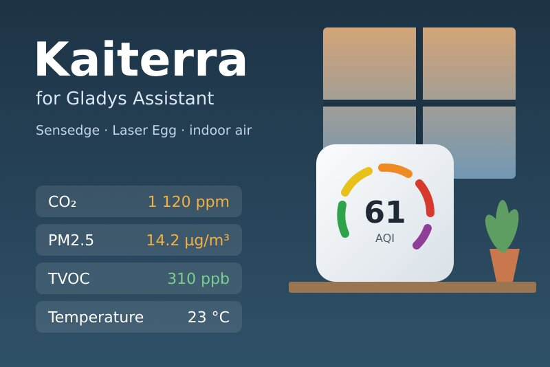
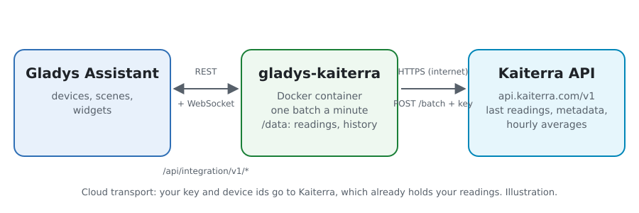
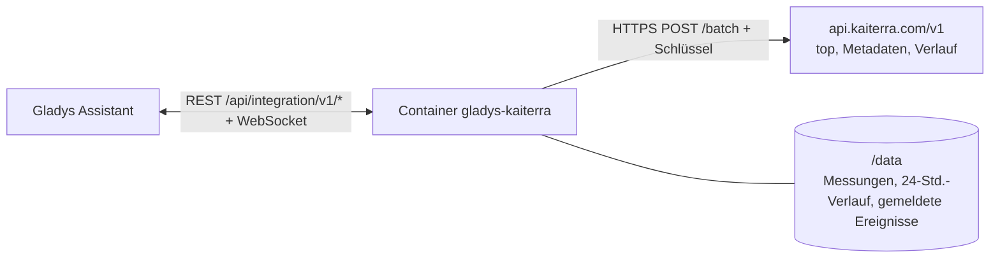
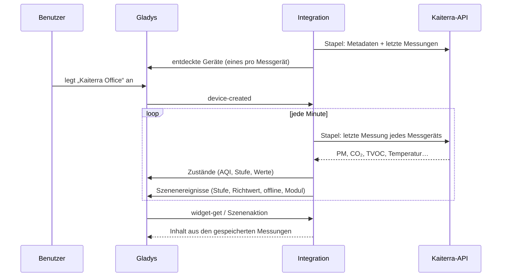
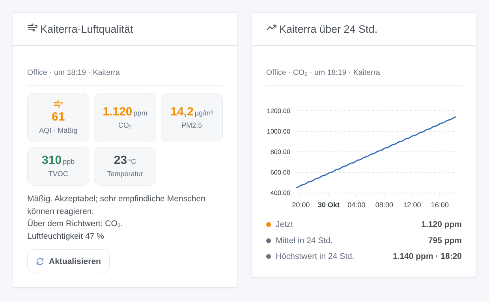

# Gladys Kaiterra

[English](README.md) · [Français](README.fr.md) · **Deutsch** · [Español](README.es.md)

[](LICENSE)
[](https://github.com/William-De71/gladys-kaiterra/releases)
[](https://github.com/William-De71/gladys-kaiterra/actions/workflows/release.yml)
[](https://gladysassistant.com)



Externe Integration für [Gladys Assistant](https://gladysassistant.com) für die Raumluft-Messgeräte von **[Kaiterra](https://www.kaiterra.com)** (Sensedge, Sensedge Mini, Laser Egg): der AQI der Partikel, PM2,5, PM10, CO₂, TVOC, Temperatur und Luftfeuchtigkeit, Szenen, wenn die Luft schlechter wird oder ein Messgerät offline geht, und Dashboard-Widgets. Sie liest die offizielle Kaiterra-API mit deinem API-Schlüssel.

## Funktionen

- **Ein Gerät pro Messgerät** (bis zu 20), benannt nach der Kaiterra-App: der US-AQI der Partikel und seine Stufe, PM2,5, PM10, CO₂, TVOC, Temperatur, Luftfeuchtigkeit sowie Luftdruck, NO₂, Ozon, Helligkeit, Bewegung und Taupunkt, wenn das Messgerät sie misst.
- **5 Szenenauslöser**, **1 Szenenaktion** und **2 Dashboard-Widgets** (siehe unten).
- Eine Anfrage pro Minute liest alle Messgeräte; Namen und Sensormodule alle 6 Stunden, Stundenmittel alle 30 Minuten, gespeichert in `/data`.
- CO₂- und TVOC-Richtwerte nach Wahl; WHO-Leitwerte für die anderen.
- Nur lesend. Knöpfe in der Konfiguration: jetzt lesen, Diagnose.
- Überall vier Sprachen: Englisch, Französisch, Deutsch, Spanisch.

## Funktionsweise





Die API kann die Geräte eines Kontos nicht auflisten: Du gibst die ID (UDID) jedes Messgeräts an. Jede Minute fragt ein `POST /batch` für alle `GET /devices/{id}/top` (die letzte Messung) ab. Die Metadaten (`GET /devices/{id}`: Name, Modell, Sensormodule) und die Stundenmittel der letzten 24 Stunden (`GET /devices/{id}/history?group_by=1h`) laufen in eigenen Stapeln. Der AQI wird aus den Partikeln berechnet, nie aus der API übernommen. Jede Messung wird mit den vorherigen verglichen, um die Auslöser zu bedienen; eine Stufe oder ein Schwellwert muss 5 Minuten anhalten, um zu zählen.



### Transport

Nur Cloud (`"transports": ["cloud"]`): Der Katalog zeigt das Cloud-Abzeichen. Die Integration kontaktiert `api.kaiterra.com` über HTTPS mit deinem Schlüssel und den IDs deiner Messgeräte; Kaiterra hat ihre Messungen ohnehin. Kaiterra hat keine lokale API, daher gibt es keinen Knopf „lokale Verbindung bevorzugen“.

## Geräte und Funktionen

| Funktion                            | Kategorie / Typ                                | Hinweis                                 |
| ----------------------------------- | ---------------------------------------------- | --------------------------------------- |
| Luftqualitätsindex (AQI)            | `airquality-sensor/aqi`                        | US-AQI aus PM2,5 und PM10, 0-500        |
| Luftqualität                        | `text/text`                                    | gut, mäßig, … gefährlich                |
| PM2,5, PM10                         | `pm25-sensor`, `pm10-sensor` / `decimal`       | µg/m³                                   |
| CO₂                                 | `co2-sensor/integer`                           | ppm                                     |
| Flüchtige organische Verbindungen   | `voc-sensor/decimal`                           | ppb                                     |
| Temperatur, Luftfeuchtigkeit, Druck | `temperature-`, `humidity-`, `pressure-sensor` | °C (bei Bedarf aus °F), %, hPa (aus Pa) |
| Stickstoffdioxid, Ozon              | `no2-sensor`, `o3-sensor` / `decimal`          | µg/m³, aus ppb umgerechnet              |
| Helligkeit, Bewegung, Taupunkt      | `light-sensor`, `motion-sensor`, `probe`       | lx, binär, °C (nicht im Raummittel)     |

Ein Gerät pro Messgerät, `should_poll: false`, angeboten, sobald es geantwortet hat, mit dem, was es misst. Ein Wert, den das Messgerät nicht hochgeladen hat, wird nicht veröffentlicht: Es wird keine 0 erfunden. Eine angebotene Funktion verschwindet nie. Die externen IDs stammen aus einem Hash der Geräte-ID: Die ID selbst erscheint nie in Gladys. PM1 und CO haben in Gladys keine Kategorie: Sie bleiben in der Szenenaktion.

## Szenenauslöser, Aktionen und Widgets



**Auslöser**

- **Luftqualität geändert**: Die AQI-Stufe ändert sich und hält 5 Minuten an. Filter: Gerät, neue Stufe, Richtung (schlechter, besser).
- **Richtwert überschritten** / **Wieder normal**: CO₂, TVOC, PM2,5, PM10, NO₂, Ozon oder CO liegt 5 Minuten über seinem Richtwert, danach unter 90 % davon. Filter: Gerät, Schadstoff.
- **Gerät offline oder zurück**: 15 Minuten keine neue Messung, oder wieder Messungen. Filter: Gerät, Zustand.
- **Sensormodul verbraucht**: Ein Sensedge-Modul hat weniger als 10 % Lebensdauer übrig.

**Aktion**: die Luft eines Geräts lesen (AQI, Stufe, alle Werte, Uhrzeit, online oder nicht, Satz `summary`).

**Widgets**: **Kaiterra-Luftqualität** (AQI, CO₂, PM2,5, TVOC, Temperatur, Rat, Aktualisieren) und **Kaiterra über 24 Std.** (Stundenmittel eines Messwerts, aktuell, Mittel, Höchstwert).

**Beispiele**

- Wenn **das CO₂ im Büro seinen Richtwert überschreitet** → eine Nachricht „Fenster öffnen“; wenn es **wieder normal** ist → eine Bestätigung.
- Wenn **die Luftqualität ungesund wird** → der Luftreiniger auf volle Stufe.
- Wenn **ein Messgerät offline geht** → eine Benachrichtigung, um sein WLAN zu prüfen.

## Voraussetzungen

- Gladys Assistant **5.3.0** oder neuer (Schlüsselwörter des Katalogs). Ältere Instanzen können die Integration nicht installieren.
- Ein oder mehrere Kaiterra-Messgeräte, eingerichtet in der Kaiterra-App, und ihre IDs (UDID).
- Ein Kaiterra-API-Schlüssel: auf [app.kaiterra.com](https://app.kaiterra.com), Account Settings → API Keys → Generate API Key (siehe [docs/de.md](docs/de.md#einen-api-schlüssel-erhalten)).

## Installation

- **Aus dem Store** von Gladys (Integrationen → Externe Integrationen), mit einem Klick, sobald indiziert.
- **Über die URL des Repositorys**: `https://github.com/William-De71/gladys-kaiterra`.
- **Entwicklermodus**: Das Image lokal bauen (`docker build -t gladys-kaiterra .`) und aus Gladys installieren.

## Konfiguration

| Feld                 | Standard    | Zweck                                                                       |
| -------------------- | ----------- | --------------------------------------------------------------------------- |
| API-Schlüssel        | —           | Der Schlüssel deines Kaiterra-Kontos (geheim).                              |
| Geräte-IDs (UDID)    | —           | Die ID jedes Messgeräts, getrennt durch Kommas oder Zeilenumbrüche; bis 20. |
| CO₂-Richtwert (ppm)  | 1.000       | Der Wert, ab dem CO₂ den Auslöser auslöst und orange wird.                  |
| TVOC-Richtwert (ppb) | 500         | Dasselbe für die flüchtigen organischen Verbindungen.                       |
| Sprache der Texte    | automatisch | Namen der Geräte und Texte der Szenen.                                      |

## Verwendung

1. Gib deinen API-Schlüssel und die IDs deiner Messgeräte ein und speichere.
2. Drück **Jetzt lesen**, um den Schlüssel zu prüfen und den AQI jedes Messgeräts zu sehen.
3. Leg im Reiter **Entdecken** die Geräte „Kaiterra …“ an.
4. Füg die Widgets **Kaiterra-Luftqualität** und **Kaiterra über 24 Std.** zu einem Dashboard hinzu und bau Szenen mit den Auslösern oben.

## Entwicklung

```bash
npm install
npm test                       # node --test, nie mit Netzwerk
npm run lint && npm run format:check
npx github:GladysAssistant/integration-store . --skip-image-check
scripts/build-cover.sh         # cover.jpg aus docs/assets/cover.svg
docs/illustrations/render.sh   # docs/assets/widgets.<lang>.png
node .github/scripts/release.mjs next
```

Lokal liest das SDK `GLADYS_HOST_API_URL`, `GLADYS_INTEGRATION_TOKEN` und `GLADYS_INTEGRATION_SELECTOR`; `DEBUG=gladys-integration-sdk` zeigt die Logs des SDK und prüft jeden Widget-Inhalt. Die Tests liefern Antworten nach den Beispielen der [Dokumentation der Kaiterra-API](https://dev.kaiterra.com) (`test/fixtures/`). Die Regeln des Projekts stehen in [CLAUDE.md](CLAUDE.md).

## Veröffentlichungsprozess


Jeder Merge auf `main` startet die CI und berechnet dann die Version aus den [Conventional Commits](https://www.conventionalcommits.org/de/) seit dem letzten Tag: `feat` → Minor, `fix` / `perf` → Patch, `!` oder `BREAKING CHANGE` → Major (ein Minor unter 1.0.0); `docs`, `chore`, `ci`, `test`, `style`, `refactor`, `build` allein veröffentlichen nichts. Der Abschnitt des Changelogs wird erzeugt, der Tag gepusht, das Multi-Architektur-Image gebaut, dann erhält `main` den Versions-Commit, die GitHub Release wird erstellt und ein letzter Job prüft das öffentliche Image, den Validator des Stores und das Topic.

- Der Titel des Pull Requests wird zum Squash-Commit und dann zur Zeile im Changelog: auf Englisch und für die Benutzer schreiben (`pr-title.yml` prüft ihn). `CHANGELOG.md` nie von Hand bearbeiten.
- 1.0.0 ist eine Entscheidung: Actions → Release → Run workflow mit `release-as: 1.0.0`. `dry-run` zeigt Version und Notizen, ohne zu veröffentlichen.
- **Geschützter Branch**: Die Veröffentlichung pusht ihren Commit mit `GITHUB_TOKEN` auf `main`. Verlangt ein Ruleset auf `main` Pull Requests oder Status-Checks, nimm GitHub Actions in seine Ausnahmeliste auf (oder pushe über eine GitHub App), sonst schlägt der Job mit Anweisungen fehl.
- Nach der ersten Version das Paket auf `ghcr.io` öffentlich machen (Package settings → Change visibility), sonst kann Gladys es nicht laden.

## Fehlerbehebung

Siehe [docs/de.md](docs/de.md#fehlerbehebung). Melde Probleme mit den Versionen von Gladys und der Integration und den Zeilen des Knopfs **Diagnose**.

## Mitwirken

Issues und Pull Requests sind willkommen. Lass vor einem Pull Request `npm run format:check && npm run lint && npm test` laufen und änder keine externe ID und keinen gespeicherten Schlüssel (siehe [CLAUDE.md](CLAUDE.md)).

## Sicherheit

Siehe [SECURITY.md](SECURITY.md): Schwachstellen bitte vertraulich melden. Der API-Schlüssel ist ein `secret`-Feld von Gladys, wird nur an `api.kaiterra.com` über HTTPS gesendet (im Parameter `key`, der einzigen Form, die die API annimmt) und nie in die Logs oder eine Fehlermeldung geschrieben; die Geräte-IDs werden ebenfalls nie protokolliert. Die Integration läuft schreibgeschützt, als Benutzer ohne Root-Rechte, in ihrem Container.

## Kommende Screenshots

Die Bilder oben sind Illustrationen, keine Screenshots. Echte Screenshots kommen in `docs/assets/screenshots/` (PNG, 1280 × 800): `configuration.png`, `discovery.png`, `device.png`, `scene.png`.

## Lizenz

[Apache-Lizenz 2.0](LICENSE) — siehe auch [NOTICE](NOTICE). Daten bereitgestellt von Kaiterra; diese Integration ist nicht mit Kaiterra verbunden. Danke an die Dokumentation und das SDK von Gladys und an Kaiterra für die öffentliche Dokumentation seiner API.
