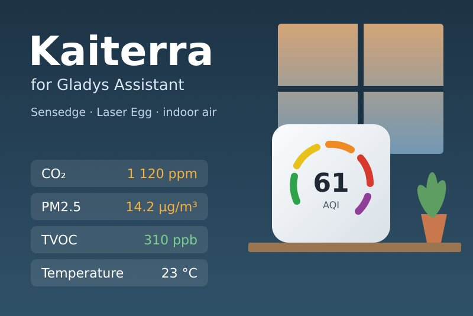
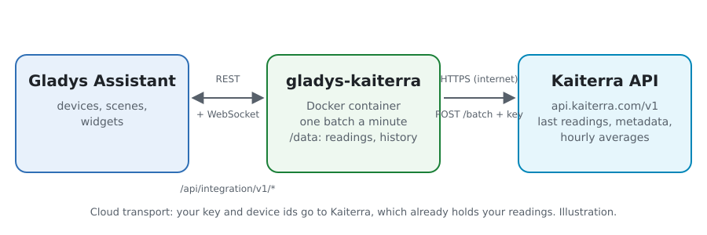
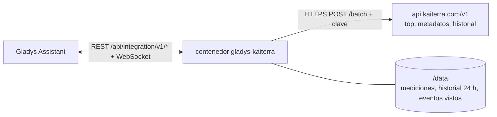
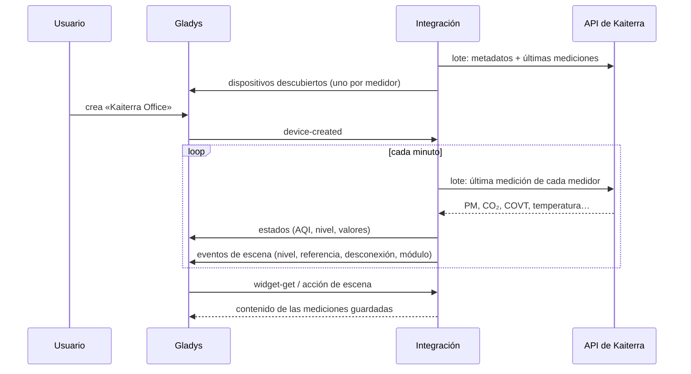
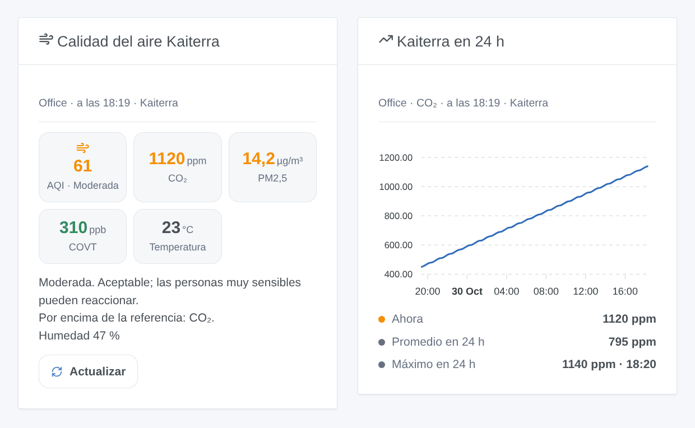

# Gladys Kaiterra

[English](README.md) · [Français](README.fr.md) · [Deutsch](README.de.md) · **Español**

[](LICENSE)
[](https://github.com/William-De71/gladys-kaiterra/releases)
[](https://github.com/William-De71/gladys-kaiterra/actions/workflows/release.yml)
[](https://gladysassistant.com)



Integración externa de [Gladys Assistant](https://gladysassistant.com) para los medidores de calidad del aire interior de **[Kaiterra](https://www.kaiterra.com)** (Sensedge, Sensedge Mini, Laser Egg): el AQI de las partículas, PM2,5, PM10, CO₂, COVT, temperatura y humedad, escenas cuando el aire empeora o un medidor se desconecta, y widgets de panel. Lee la API oficial de Kaiterra con su clave de API.

## Funcionalidades

- **Un dispositivo por medidor** (hasta 20), con el nombre de la app Kaiterra: el AQI estadounidense de las partículas y su nivel, PM2,5, PM10, CO₂, COVT, temperatura, humedad, y la presión, el NO₂, el ozono, la luminosidad, el movimiento y el punto de rocío cuando el medidor los mide.
- **5 desencadenantes de escena**, **1 acción de escena** y **2 widgets** (abajo).
- Una solicitud por minuto lee todos los medidores; nombres y módulos cada 6 horas, promedios horarios cada 30 minutos, guardados en `/data`.
- Referencias de CO₂ y COVT a su elección; valores guía de la OMS para los demás.
- Solo lectura. Botones de configuración: leer ahora, diagnóstico.
- Cuatro idiomas en todas partes: inglés, francés, alemán, español.

## Funcionamiento





La API no puede listar los dispositivos de una cuenta: usted indica el identificador (UDID) de cada medidor. Cada minuto, un `POST /batch` pide `GET /devices/{id}/top` (la última medición) para todos. Los metadatos (`GET /devices/{id}`: nombre, modelo, módulos de sensores) y los promedios horarios de las últimas 24 horas (`GET /devices/{id}/history?group_by=1h`) van en lotes propios. El AQI se calcula a partir de las partículas, nunca se toma de la API. Cada medición se compara con las anteriores para los desencadenantes; un nivel o un umbral debe mantenerse 5 minutos para contar.



### Transporte

Solo nube (`"transports": ["cloud"]`): el catálogo muestra la insignia de nube. La integración contacta con `api.kaiterra.com` por HTTPS con su clave y los identificadores de sus medidores; Kaiterra ya tiene sus mediciones. Kaiterra no tiene API local, así que no hay botón «preferir la conexión local».

## Dispositivos y funcionalidades

| Funcionalidad                           | Categoría / tipo                               | Nota                                            |
| --------------------------------------- | ---------------------------------------------- | ----------------------------------------------- |
| Índice de calidad del aire (AQI)        | `airquality-sensor/aqi`                        | AQI estadounidense de PM2,5 y PM10, 0-500       |
| Calidad del aire                        | `text/text`                                    | buena, moderada, … peligrosa                    |
| PM2,5, PM10                             | `pm25-sensor`, `pm10-sensor` / `decimal`       | µg/m³                                           |
| CO₂                                     | `co2-sensor/integer`                           | ppm                                             |
| Compuestos orgánicos volátiles          | `voc-sensor/decimal`                           | ppb                                             |
| Temperatura, humedad, presión           | `temperature-`, `humidity-`, `pressure-sensor` | °C (desde °F si hace falta), %, hPa (desde Pa)  |
| Dióxido de nitrógeno, ozono             | `no2-sensor`, `o3-sensor` / `decimal`          | µg/m³, convertidos desde ppb                    |
| Luminosidad, movimiento, punto de rocío | `light-sensor`, `motion-sensor`, `probe`       | lx, binario, °C (fuera del promedio de la sala) |

Un dispositivo por medidor, `should_poll: false`, ofrecido en cuanto respondió, con lo que mide. Un valor que el medidor no envió no se publica: no se inventa ningún 0. Una funcionalidad ofrecida no desaparece nunca. Los identificadores externos vienen de un hash del identificador del dispositivo: este nunca aparece en Gladys. Las PM1 y el CO no tienen categoría en Gladys: se quedan en la acción de escena.

## Desencadenantes, acciones de escena y widgets



**Desencadenantes**

- **Cambio de calidad del aire**: el nivel AQI cambia y se mantiene 5 minutos. Filtros: dispositivo, nuevo nivel, sentido (empeora, mejora).
- **Valor de referencia superado** / **Vuelta a la normalidad**: CO₂, COVT, PM2,5, PM10, NO₂, ozono o CO permanece por encima de su referencia durante 5 minutos, y luego por debajo del 90 % de ella. Filtros: dispositivo, contaminante.
- **Dispositivo desconectado o de vuelta**: ninguna medición nueva durante 15 minutos, o mediciones de nuevo. Filtros: dispositivo, estado.
- **Módulo de sensor desgastado**: a un módulo de Sensedge le queda menos del 10 % de vida útil.

**Acción**: leer el aire de un dispositivo (AQI, nivel, todos los valores, hora, conectado o no, frase `summary`).

**Widgets**: **Calidad del aire Kaiterra** (AQI, CO₂, PM2,5, COVT, temperatura, consejo, Actualizar) y **Kaiterra en 24 h** (promedios horarios de una medida, actual, promedio, máximo).

**Ejemplos**

- Cuando **el CO₂ de la oficina supera su referencia** → un mensaje «abra una ventana»; cuando **vuelve a la normalidad** → una confirmación.
- Cuando **la calidad del aire se vuelve dañina** → el purificador a toda velocidad.
- Cuando **un medidor se desconecta** → una notificación para comprobar su Wi-Fi.

## Requisitos previos

- Gladys Assistant **5.3.0** o posterior (palabras clave del catálogo). Las instancias anteriores no pueden instalar la integración.
- Uno o varios medidores Kaiterra configurados en la app Kaiterra, y sus identificadores (UDID).
- Una clave de API de Kaiterra: en [app.kaiterra.com](https://app.kaiterra.com), Account Settings → API Keys → Generate API Key (ver [docs/es.md](docs/es.md#obtener-una-clave-de-api)).

## Instalación

- **Desde la tienda** de Gladys (Integraciones → Integraciones externas), en un clic, una vez indexada.
- **Desde la URL del repositorio**: `https://github.com/William-De71/gladys-kaiterra`.
- **Modo desarrollador**: construya la imagen en local (`docker build -t gladys-kaiterra .`) e instálela desde Gladys.

## Configuración

| Campo                                      | Por defecto | Función                                                                            |
| ------------------------------------------ | ----------- | ---------------------------------------------------------------------------------- |
| Clave de API                               | —           | La clave de su cuenta Kaiterra (secreta).                                          |
| Identificadores de los dispositivos (UDID) | —           | El identificador de cada medidor, separados por comas o saltos de línea; hasta 20. |
| Referencia de CO₂ (ppm)                    | 1000        | El valor por encima del cual el CO₂ activa el desencadenante y se vuelve naranja.  |
| Referencia de COVT (ppb)                   | 500         | Lo mismo para los compuestos orgánicos volátiles.                                  |
| Idioma de los textos                       | automático  | Nombres de los dispositivos y textos de las escenas.                               |

## Uso

1. Introduzca su clave de API y los identificadores de sus medidores, y guarde.
2. Pulse **Leer ahora** para comprobar la clave y ver el AQI de cada medidor.
3. En la pestaña **Descubrir**, cree los dispositivos «Kaiterra …».
4. Añada los widgets **Calidad del aire Kaiterra** y **Kaiterra en 24 h** a un panel, y cree escenas con los desencadenantes de arriba.

## Desarrollo

```bash
npm install
npm test                       # node --test, nunca toca la red
npm run lint && npm run format:check
npx github:GladysAssistant/integration-store . --skip-image-check
scripts/build-cover.sh         # cover.jpg desde docs/assets/cover.svg
docs/illustrations/render.sh   # docs/assets/widgets.<lang>.png
node .github/scripts/release.mjs next
```

En local, el SDK lee `GLADYS_HOST_API_URL`, `GLADYS_INTEGRATION_TOKEN` y `GLADYS_INTEGRATION_SELECTOR`; `DEBUG=gladys-integration-sdk` muestra los registros del SDK y comprueba cada contenido de widget. Las pruebas sirven respuestas construidas a partir de los ejemplos de la [documentación de la API de Kaiterra](https://dev.kaiterra.com) (`test/fixtures/`). Las reglas del proyecto están en [CLAUDE.md](CLAUDE.md).

## Proceso de publicación


Cada fusión en `main` lanza la CI y luego calcula la versión a partir de los [Conventional Commits](https://www.conventionalcommits.org/es/) desde la última etiqueta: `feat` → menor, `fix` / `perf` → parche, `!` o `BREAKING CHANGE` → mayor (una menor por debajo de 1.0.0); `docs`, `chore`, `ci`, `test`, `style`, `refactor`, `build` solos no publican nada. Se genera la sección del changelog, se empuja la etiqueta, se construye la imagen multiarquitectura, luego `main` recibe el commit de versión, se crea la GitHub Release y un último trabajo comprueba la imagen pública, el validador de la tienda y el topic.

- El título de la pull request se convierte en el commit de squash y luego en la línea del changelog: escríbalo en inglés, para el usuario (`pr-title.yml` lo comprueba). No edite nunca `CHANGELOG.md` a mano.
- La 1.0.0 es una decisión: Actions → Release → Run workflow con `release-as: 1.0.0`. `dry-run` muestra la versión y las notas sin publicar nada.
- **Rama protegida**: la publicación empuja su commit a `main` con `GITHUB_TOKEN`. Con un ruleset que exija pull requests o status checks en `main`, añada GitHub Actions a su lista de omisión (o empuje mediante una GitHub App); si no, el trabajo de publicación falla con instrucciones.
- Tras la primera versión, haga público el paquete de `ghcr.io` (Package settings → Change visibility); si no, Gladys no puede descargarlo.

## Solución de problemas

Ver [docs/es.md](docs/es.md#solución-de-problemas). Informe de los problemas con las versiones de Gladys y de la integración, y las líneas del botón **Diagnóstico**.

## Contribuir

Las issues y pull requests son bienvenidas. Ejecute `npm run format:check && npm run lint && npm test` antes de abrir una pull request y no cambie ningún identificador externo ni ninguna clave guardada (ver [CLAUDE.md](CLAUDE.md)).

## Seguridad

Ver [SECURITY.md](SECURITY.md): informe de las vulnerabilidades en privado. La clave de API es un campo `secret` de Gladys, enviada solo a `api.kaiterra.com` por HTTPS (en el parámetro `key`, la única forma que acepta la API), nunca escrita en los registros ni en un mensaje de error; los identificadores de los dispositivos tampoco se registran nunca. La integración funciona en solo lectura, con un usuario sin privilegios de root, en su contenedor.

## Capturas por venir

Las imágenes de arriba son ilustraciones, no capturas de pantalla. Las capturas reales irán en `docs/assets/screenshots/` (PNG, 1280 × 800): `configuration.png`, `discovery.png`, `device.png`, `scene.png`.

## Licencia

[Licencia Apache 2.0](LICENSE) — ver también [NOTICE](NOTICE). Datos proporcionados por Kaiterra; esta integración no está afiliada a Kaiterra. Gracias a la documentación y al SDK de Gladys, y a Kaiterra por la documentación pública de su API.
