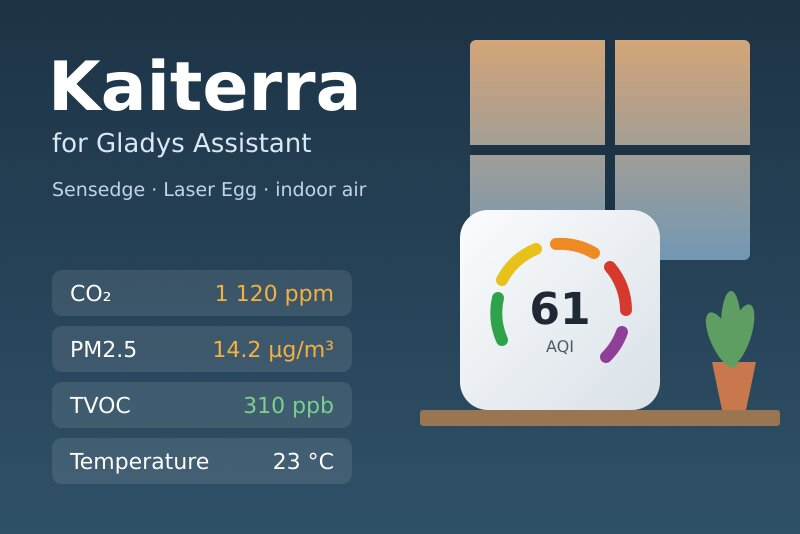
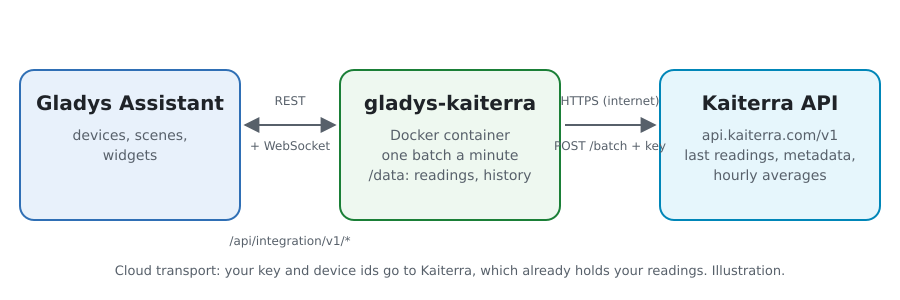
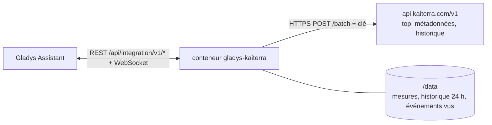
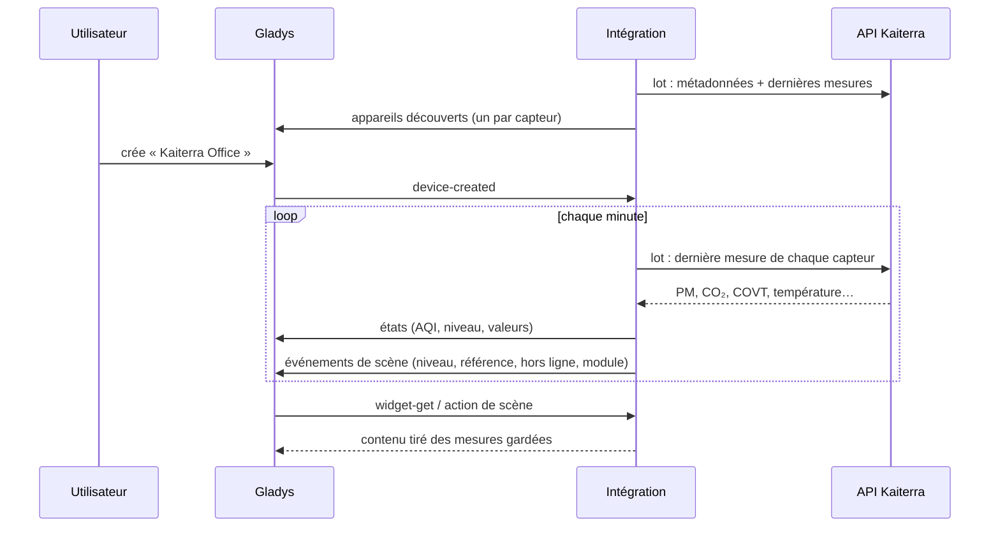
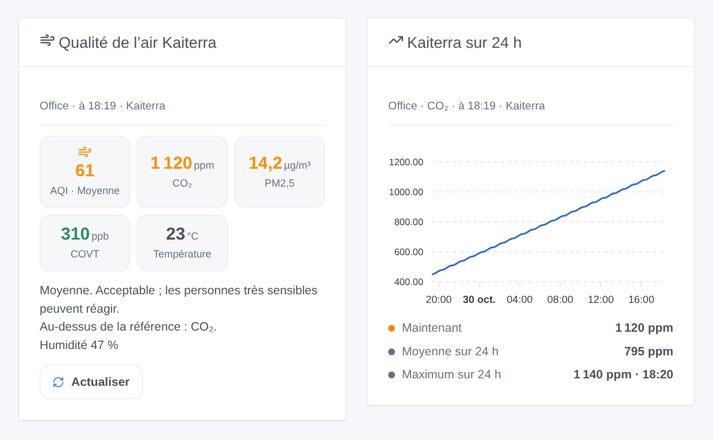

# Gladys Kaiterra

[English](README.md) · **Français** · [Deutsch](README.de.md) · [Español](README.es.md)

[](LICENSE)
[](https://github.com/William-De71/gladys-kaiterra/releases)
[](https://github.com/William-De71/gladys-kaiterra/actions/workflows/release.yml)
[](https://gladysassistant.com)



Intégration externe [Gladys Assistant](https://gladysassistant.com) pour les capteurs de qualité de l’air intérieur **[Kaiterra](https://www.kaiterra.com)** (Sensedge, Sensedge Mini, Laser Egg) : l’AQI des particules, PM2,5, PM10, CO₂, COVT, température et humidité, des scènes quand l’air se dégrade ou qu’un capteur se déconnecte, et des widgets de tableau de bord. Elle lit l’API officielle de Kaiterra avec votre clé d’API.

## Fonctionnalités

- **Un appareil par capteur** (20 au plus), nommé d’après l’appli Kaiterra : l’AQI américain des particules et son niveau, PM2,5, PM10, CO₂, COVT, température, humidité, et la pression, le NO₂, l’ozone, la luminosité, les mouvements et le point de rosée quand le capteur les mesure.
- **5 déclencheurs de scène**, **1 action de scène** et **2 widgets** (ci-dessous).
- Une requête par minute lit tous les capteurs ; noms et modules toutes les 6 heures, moyennes horaires toutes les 30 minutes, gardés dans `/data`.
- Références CO₂ et COVT à votre choix ; valeurs guides de l’OMS pour les autres.
- Lecture seule. Boutons de configuration : lire maintenant, diagnostic.
- Quatre langues partout : anglais, français, allemand, espagnol.

## Fonctionnement





L’API ne sait pas lister les appareils d’un compte : vous donnez l’identifiant (UDID) de chaque capteur. Chaque minute, un `POST /batch` demande `GET /devices/{id}/top` (la dernière mesure) pour tous. Les métadonnées (`GET /devices/{id}` : nom, modèle, modules de capteurs) et les moyennes horaires des dernières 24 heures (`GET /devices/{id}/history?group_by=1h`) passent dans des lots à part. L’AQI est calculé à partir des particules, jamais repris de l’API. Chaque mesure est comparée aux précédentes pour les déclencheurs ; un niveau ou un seuil doit tenir 5 minutes pour compter.



### Transport

Cloud uniquement (`"transports": ["cloud"]`) : le catalogue affiche le badge cloud. L’intégration contacte `api.kaiterra.com` en HTTPS avec votre clé et les identifiants de vos capteurs ; Kaiterra détient déjà leurs mesures. Kaiterra n’a pas d’API locale : il n’y a donc pas de bouton « préférer la connexion locale ».

## Appareils et fonctionnalités

| Fonctionnalité                        | Catégorie / type                               | Remarque                                         |
| ------------------------------------- | ---------------------------------------------- | ------------------------------------------------ |
| Indice de qualité de l’air (AQI)      | `airquality-sensor/aqi`                        | AQI américain des PM2,5 et PM10, 0-500           |
| Qualité de l’air                      | `text/text`                                    | bonne, moyenne, … dangereuse                     |
| PM2,5, PM10                           | `pm25-sensor`, `pm10-sensor` / `decimal`       | µg/m³                                            |
| CO₂                                   | `co2-sensor/integer`                           | ppm                                              |
| Composés organiques volatils          | `voc-sensor/decimal`                           | ppb                                              |
| Température, humidité, pression       | `temperature-`, `humidity-`, `pressure-sensor` | °C (depuis les °F si besoin), %, hPa (depuis Pa) |
| Dioxyde d’azote, ozone                | `no2-sensor`, `o3-sensor` / `decimal`          | µg/m³, convertis des ppb                         |
| Luminosité, mouvement, point de rosée | `light-sensor`, `motion-sensor`, `probe`       | lx, binaire, °C (hors moyenne de la pièce)       |

Un appareil par capteur, `should_poll: false`, proposé dès qu’il a répondu, avec ce qu’il mesure. Une valeur que le capteur n’a pas envoyée n’est pas publiée : aucun 0 n’est inventé. Une fonctionnalité proposée ne disparaît jamais. Les identifiants externes viennent d’une empreinte de l’identifiant de l’appareil : celui-ci n’apparaît jamais dans Gladys. Les PM1 et le CO n’ont pas de catégorie dans Gladys : ils restent dans l’action de scène.

## Déclencheurs, actions de scène et widgets



**Déclencheurs**

- **Qualité de l’air changée** : le niveau AQI change et tient 5 minutes. Filtres : appareil, nouveau niveau, sens (dégradation, amélioration).
- **Valeur de référence dépassée** / **Retour à la normale** : CO₂, COVT, PM2,5, PM10, NO₂, ozone ou CO reste au-dessus de sa référence pendant 5 minutes, puis sous 90 % de celle-ci. Filtres : appareil, polluant.
- **Appareil hors ligne ou de retour** : aucune nouvelle mesure depuis 15 minutes, ou de nouveau des mesures. Filtres : appareil, état.
- **Module de capteur usé** : un module de Sensedge a moins de 10 % de durée de vie restante.

**Action** : lire l’air d’un appareil (AQI, niveau, toutes les valeurs, heure, en ligne ou non, phrase `summary`).

**Widgets** : **Qualité de l’air Kaiterra** (AQI, CO₂, PM2,5, COVT, température, conseil, Actualiser) et **Kaiterra sur 24 h** (moyennes horaires d’une mesure, actuelle, moyenne, maximum).

**Exemples**

- Quand **le CO₂ du bureau dépasse sa référence** → un message « ouvrez une fenêtre » ; quand il **revient à la normale** → une confirmation.
- Quand **la qualité de l’air devient mauvaise** → le purificateur à pleine vitesse.
- Quand **un capteur se déconnecte** → une notification pour vérifier son Wi-Fi.

## Prérequis

- Gladys Assistant **5.3.0** ou plus récent (mots-clés du catalogue). Les instances plus anciennes ne peuvent pas installer l’intégration.
- Un ou plusieurs capteurs Kaiterra configurés dans l’appli Kaiterra, et leurs identifiants (UDID).
- Une clé d’API Kaiterra : sur [app.kaiterra.com](https://app.kaiterra.com), Account Settings → API Keys → Generate API Key (voir [docs/fr.md](docs/fr.md#obtenir-une-clé-dapi)).

## Installation

- **Depuis le store** de Gladys (Intégrations → Intégrations externes), en un clic, une fois indexée.
- **Depuis l’URL du dépôt** : `https://github.com/William-De71/gladys-kaiterra`.
- **Mode développeur** : construisez l’image en local (`docker build -t gladys-kaiterra .`) et installez-la depuis Gladys.

## Configuration

| Champ                             | Par défaut  | Rôle                                                                                              |
| --------------------------------- | ----------- | ------------------------------------------------------------------------------------------------- |
| Clé d’API                         | —           | La clé de votre compte Kaiterra (secret).                                                         |
| Identifiants des appareils (UDID) | —           | L’identifiant de chaque capteur, séparés par des virgules ou des retours à la ligne ; 20 au plus. |
| Référence CO₂ (ppm)               | 1 000       | La valeur au-delà de laquelle le CO₂ active le déclencheur et passe en orange.                    |
| Référence COVT (ppb)              | 500         | La même chose pour les composés organiques volatils.                                              |
| Langue des textes                 | automatique | Noms des appareils et textes des scènes.                                                          |

## Utilisation

1. Saisissez votre clé d’API et les identifiants de vos capteurs, puis enregistrez.
2. Appuyez sur **Lire maintenant** pour vérifier la clé et voir l’AQI de chaque capteur.
3. Dans l’onglet **Découverte**, créez les appareils « Kaiterra … ».
4. Ajoutez les widgets **Qualité de l’air Kaiterra** et **Kaiterra sur 24 h** à un tableau de bord, et construisez des scènes avec les déclencheurs ci-dessus.

## Développement

```bash
npm install
npm test                       # node --test, ne touche jamais le réseau
npm run lint && npm run format:check
npx github:GladysAssistant/integration-store . --skip-image-check
scripts/build-cover.sh         # cover.jpg depuis docs/assets/cover.svg
docs/illustrations/render.sh   # docs/assets/widgets.<lang>.png
node .github/scripts/release.mjs next
```

En local, le SDK lit `GLADYS_HOST_API_URL`, `GLADYS_INTEGRATION_TOKEN` et `GLADYS_INTEGRATION_SELECTOR` ; `DEBUG=gladys-integration-sdk` affiche les journaux du SDK et vérifie chaque contenu de widget. Les tests servent des réponses construites d’après les exemples de la [documentation de l’API Kaiterra](https://dev.kaiterra.com) (`test/fixtures/`). Les règles du projet sont dans [CLAUDE.md](CLAUDE.md).

## Processus de publication


Chaque fusion sur `main` lance la CI, puis calcule la version d’après les [Conventional Commits](https://www.conventionalcommits.org/fr/) depuis le dernier tag : `feat` → mineure, `fix` / `perf` → correctif, `!` ou `BREAKING CHANGE` → majeure (une mineure sous 1.0.0) ; `docs`, `chore`, `ci`, `test`, `style`, `refactor`, `build` seuls ne publient rien. La section du changelog est générée, le tag poussé, l’image multi-architecture construite, puis `main` reçoit le commit de version, la GitHub Release est créée et un dernier job vérifie l’image publique, le validateur du store et le topic.

- Le titre de la pull request devient le commit de squash, puis la ligne du changelog : écrivez-le en anglais, pour l’utilisateur (`pr-title.yml` le vérifie). Ne modifiez jamais `CHANGELOG.md` à la main.
- La 1.0.0 est une décision : Actions → Release → Run workflow avec `release-as: 1.0.0`. `dry-run` montre la version et les notes sans rien publier.
- **Branche protégée** : la publication pousse son commit sur `main` avec `GITHUB_TOKEN`. Avec un ruleset qui exige des pull requests ou des status checks sur `main`, ajoutez GitHub Actions à sa liste de contournement (ou poussez via une GitHub App), sinon le job de publication échoue avec des instructions.
- Après la première version, rendez public le package `ghcr.io` (Package settings → Change visibility), sinon Gladys ne peut pas le télécharger.

## Dépannage

Voir [docs/fr.md](docs/fr.md#dépannage). Signalez les problèmes avec les versions de Gladys et de l’intégration, et les lignes du bouton **Diagnostic**.

## Contribuer

Les issues et pull requests sont les bienvenues. Lancez `npm run format:check && npm run lint && npm test` avant d’ouvrir une pull request, et ne changez aucun identifiant externe ni aucune clé enregistrée (voir [CLAUDE.md](CLAUDE.md)).

## Sécurité

Voir [SECURITY.md](SECURITY.md) : signalez les vulnérabilités en privé. La clé d’API est un champ `secret` de Gladys, envoyée seulement à `api.kaiterra.com` en HTTPS (dans le paramètre `key`, la seule façon dont l’API l’accepte), jamais écrite dans les journaux ni dans un message d’erreur ; les identifiants des appareils ne sont jamais journalisés non plus. L’intégration tourne en lecture seule, avec un utilisateur non root, dans son conteneur.

## Captures à venir

Les images ci-dessus sont des illustrations, pas des captures d’écran. Les vraies captures iront dans `docs/assets/screenshots/` (PNG, 1280 × 800) : `configuration.png`, `discovery.png`, `device.png`, `scene.png`.

## Licence

[Licence Apache 2.0](LICENSE) — voir aussi [NOTICE](NOTICE). Données fournies par Kaiterra ; cette intégration n’est pas affiliée à Kaiterra. Merci à la documentation et au SDK de Gladys, et à Kaiterra pour la documentation publique de son API.
