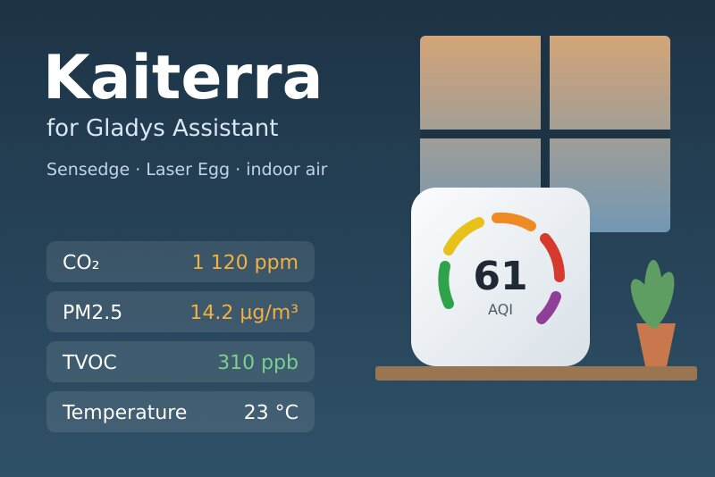
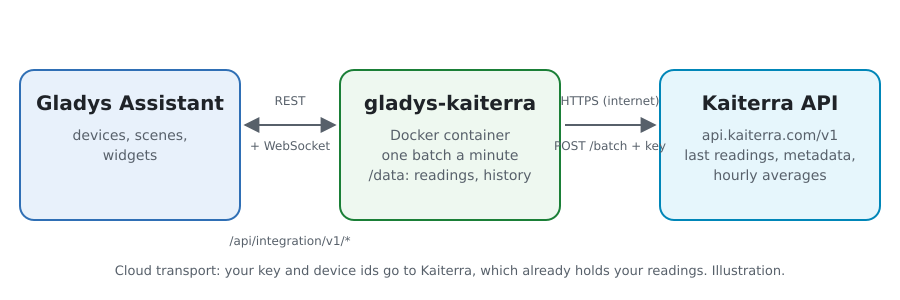
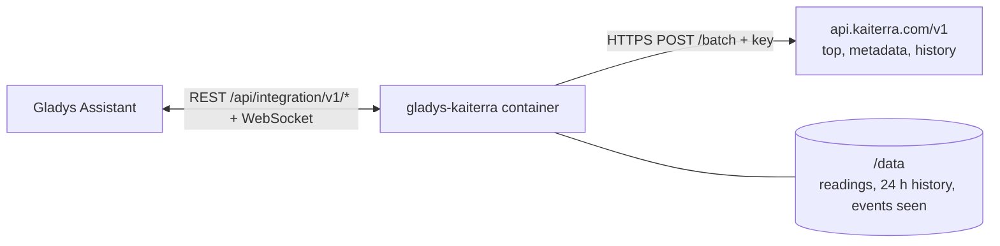
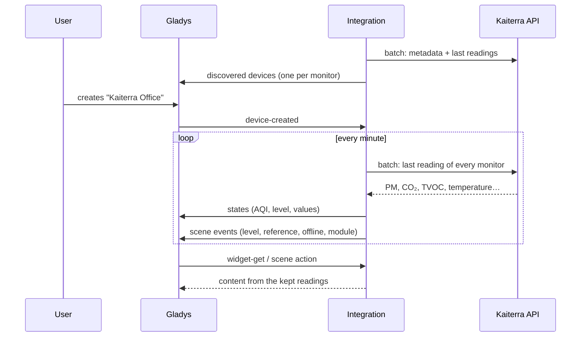
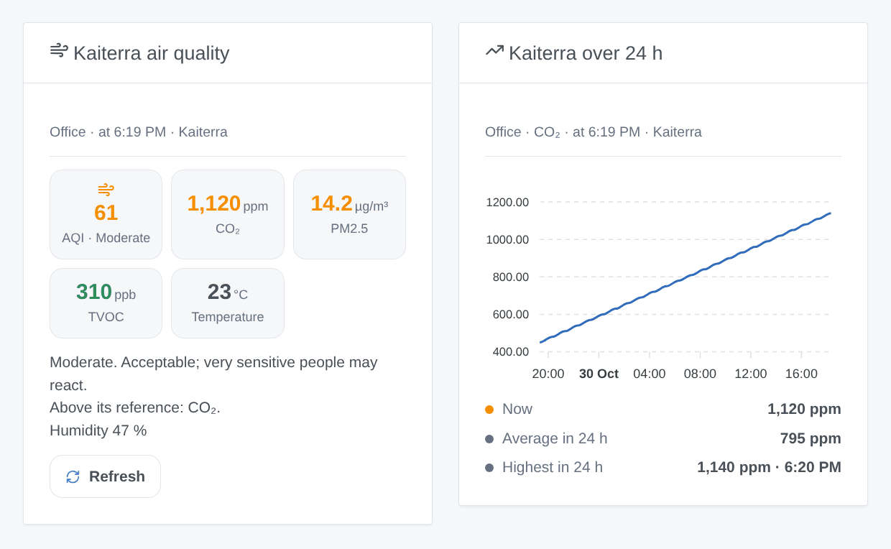

# Gladys Kaiterra

**English** · [Français](README.fr.md) · [Deutsch](README.de.md) · [Español](README.es.md)

[](LICENSE)
[](https://github.com/William-De71/gladys-kaiterra/releases)
[](https://github.com/William-De71/gladys-kaiterra/actions/workflows/release.yml)
[](https://gladysassistant.com)



[Gladys Assistant](https://gladysassistant.com) external integration for the indoor air quality monitors of **[Kaiterra](https://www.kaiterra.com)** (Sensedge, Sensedge Mini, Laser Egg): the AQI of the particles, PM2.5, PM10, CO₂, TVOC, temperature and humidity, scenes when the air gets worse or a monitor goes offline, and dashboard widgets. It reads the official Kaiterra API with your API key.

## Features

- **One device per monitor** (up to 20), named after the Kaiterra app: the US AQI of the particles and its level, PM2.5, PM10, CO₂, TVOC, temperature, humidity, and the pressure, NO₂, ozone, illuminance, motion and dew point when the monitor measures them.
- **5 scene triggers**, **1 scene action** and **2 dashboard widgets** (below).
- One request a minute reads every monitor; names and sensor modules every 6 hours, hourly averages every 30 minutes, kept in `/data`.
- CO₂ and TVOC references of your choice; WHO guideline values for the others.
- Read only. Configuration buttons: read now, diagnostic.
- Four languages everywhere: English, French, German, Spanish.

## How it works





The API cannot list the devices of an account: you give the id (UDID) of each monitor. Every minute, one `POST /batch` asks `GET /devices/{id}/top` (the last reading) for all of them. The metadata (`GET /devices/{id}`: name, model, sensor modules) and the hourly averages of the last 24 hours (`GET /devices/{id}/history?group_by=1h`) ride in batches of their own. The AQI is computed from the particles, never taken from the API. Each reading is compared with the previous ones to fire the scene triggers; a level or a threshold must hold for 5 minutes before it counts.



### Transport

Cloud only (`"transports": ["cloud"]`): the catalog shows the cloud badge. The integration contacts `api.kaiterra.com` over HTTPS with your key and the ids of your monitors; Kaiterra already holds their readings. Kaiterra has no local API, so there is no "prefer the local connection" button.

## Devices and features

| Feature                         | Category / type                                | Note                                          |
| ------------------------------- | ---------------------------------------------- | --------------------------------------------- |
| Air quality index (AQI)         | `airquality-sensor/aqi`                        | US AQI of PM2.5 and PM10, 0-500               |
| Air quality                     | `text/text`                                    | good, moderate, … hazardous                   |
| PM2.5, PM10                     | `pm25-sensor`, `pm10-sensor` / `decimal`       | µg/m³                                         |
| CO₂                             | `co2-sensor/integer`                           | ppm                                           |
| Volatile organic compounds      | `voc-sensor/decimal`                           | ppb                                           |
| Temperature, humidity, pressure | `temperature-`, `humidity-`, `pressure-sensor` | °C (from °F if need be), %, hPa (from Pa)     |
| Nitrogen dioxide, ozone         | `no2-sensor`, `o3-sensor` / `decimal`          | µg/m³, converted from ppb                     |
| Illuminance, motion, dew point  | `light-sensor`, `motion-sensor`, `probe`       | lx, binary, °C (kept out of the room average) |

One device per monitor, `should_poll: false`, offered once it answered, with what it measures. A value the monitor did not upload is not published: no 0 is invented. A feature, once offered, never goes away. External ids come from a hash of the device id: the id itself never shows in Gladys. PM1 and CO have no category in Gladys: they stay in the scene action.

## Scene triggers, actions and widgets



**Triggers**

- **Air quality changed**: the AQI level changes and holds 5 minutes. Filters: device, new level, direction (worse, better).
- **Reference value exceeded** / **Back to normal**: CO₂, TVOC, PM2.5, PM10, NO₂, ozone or CO stays over its reference for 5 minutes, then below 90 % of it. Filters: device, pollutant.
- **Device offline or back**: no new reading for 15 minutes, or readings again. Filters: device, state.
- **Sensor module worn**: a Sensedge module has less than 10 % of its life left.

**Action**: read the air of a device (AQI, level, every value, time, online or not, `summary` sentence).

**Widgets**: **Kaiterra air quality** (AQI, CO₂, PM2.5, TVOC, temperature, advice, Refresh) and **Kaiterra over 24 h** (hourly averages of one measure, now, average, highest).

**Examples**

- When **the CO₂ of the office exceeds its reference** → a message "open a window"; when it is **back to normal** → a confirmation.
- When **the air quality becomes unhealthy** → the air purifier at full speed.
- When **a monitor goes offline** → a notification to check its Wi-Fi.

## Requirements

- Gladys Assistant **5.3.0** or later (catalog keywords). Older instances cannot install the integration.
- One or more Kaiterra monitors set up in the Kaiterra app, and their ids (UDID).
- A Kaiterra API key: at [app.kaiterra.com](https://app.kaiterra.com), Account Settings → API Keys → Generate API Key (see [docs/en.md](docs/en.md#get-an-api-key)).

## Installation

- **From the store** of Gladys (Integrations → External integrations), in one click, once indexed.
- **From the repository URL**: `https://github.com/William-De71/gladys-kaiterra`.
- **Developer mode**: build the image locally (`docker build -t gladys-kaiterra .`) and install it from Gladys.

## Configuration

| Field                 | Default   | Role                                                                |
| --------------------- | --------- | ------------------------------------------------------------------- |
| API key               | —         | The key of your Kaiterra account (secret).                          |
| Device ids (UDID)     | —         | The id of each monitor, separated by commas or new lines; up to 20. |
| CO₂ reference (ppm)   | 1,000     | The value over which the CO₂ fires the trigger and turns orange.    |
| TVOC reference (ppb)  | 500       | The same for the volatile organic compounds.                        |
| Language of the texts | automatic | Device names and scene texts.                                       |

## Usage

1. Enter your API key and the ids of your monitors, then save.
2. Press **Read now** to check the key and see the AQI of each monitor.
3. In the **Discover** tab, create the "Kaiterra …" devices.
4. Add the **Kaiterra air quality** and **Kaiterra over 24 h** widgets to a dashboard, and build scenes with the triggers above.

## Development

```bash
npm install
npm test                       # node --test, never touches the network
npm run lint && npm run format:check
npx github:GladysAssistant/integration-store . --skip-image-check
scripts/build-cover.sh         # cover.jpg from docs/assets/cover.svg
docs/illustrations/render.sh   # docs/assets/widgets.<lang>.png
node .github/scripts/release.mjs next
```

Locally, the SDK reads `GLADYS_HOST_API_URL`, `GLADYS_INTEGRATION_TOKEN` and `GLADYS_INTEGRATION_SELECTOR`; `DEBUG=gladys-integration-sdk` shows the SDK logs and checks every widget content. The tests serve answers built after the examples of the [Kaiterra API documentation](https://dev.kaiterra.com) (`test/fixtures/`). The rules of the project are in [CLAUDE.md](CLAUDE.md).

## Release process


Every merge on `main` runs the CI, then computes the version from the [Conventional Commits](https://www.conventionalcommits.org/) since the last tag: `feat` → minor, `fix` / `perf` → patch, `!` or `BREAKING CHANGE` → major (a minor below 1.0.0); `docs`, `chore`, `ci`, `test`, `style`, `refactor`, `build` alone publish nothing. The changelog section is generated, the tag pushed, the multi-architecture image built, then `main` receives the release commit, the GitHub Release is created and a last job checks the public image, the store validator and the topic.

- The pull request title becomes the squash commit, then the changelog line: write it in English, for the user (`pr-title.yml` checks it). Never edit `CHANGELOG.md` by hand.
- 1.0.0 is a decision: Actions → Release → Run workflow with `release-as: 1.0.0`. `dry-run` shows the version and the notes without publishing.
- **Protected branch**: the release pushes its commit to `main` with `GITHUB_TOKEN`. With a ruleset requiring pull requests or status checks on `main`, add GitHub Actions to its bypass list (or push through a GitHub App), otherwise the publish job fails with instructions.
- After the first release, make the `ghcr.io` package public (Package settings → Change visibility), or Gladys cannot pull it.

## Troubleshooting

See [docs/en.md](docs/en.md#troubleshooting). Report issues with the versions of Gladys and of the integration, and the lines of the **Diagnostic** button.

## Contributing

Issues and pull requests are welcome. Run `npm run format:check && npm run lint && npm test` before opening a pull request, and keep every external id and stored key unchanged (see [CLAUDE.md](CLAUDE.md)).

## Security

See [SECURITY.md](SECURITY.md): report vulnerabilities privately. The API key is a `secret` field of Gladys, sent only to `api.kaiterra.com` over HTTPS (in the `key` parameter, the only way the API takes it), never written to the logs nor to an error message; the device ids are never logged either. The integration runs read-only, as a non-root user, in its container.

## Screenshots to come

The images above are illustrations, not screenshots. Real screenshots will go in `docs/assets/screenshots/` (PNG, 1280 × 800): `configuration.png`, `discovery.png`, `device.png`, `scene.png`.

## License

[Apache License 2.0](LICENSE) — see also [NOTICE](NOTICE). Data provided by Kaiterra; this integration is not affiliated with Kaiterra. Thanks to the Gladys documentation and SDK, and to Kaiterra for its public API documentation.
