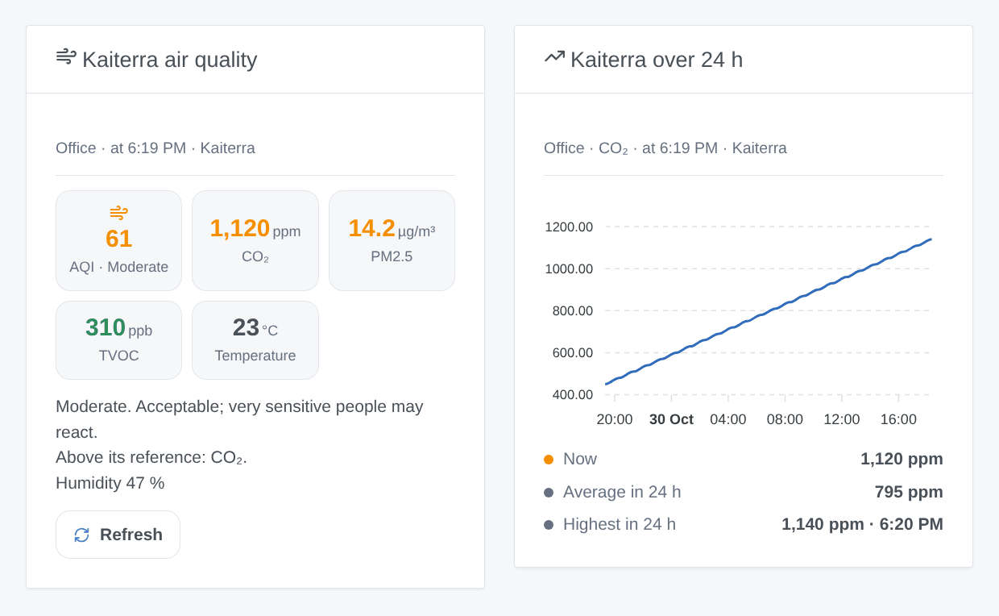

# Kaiterra

## Overview

[Kaiterra](https://www.kaiterra.com) makes indoor air quality monitors: the **Sensedge** and **Sensedge Mini** for offices and homes, and the **Laser Egg** family. Depending on the model and its sensor modules, they measure **particulate matter** (PM1, PM2.5, PM10), **CO₂**, **volatile organic compounds** (TVOC), temperature, humidity, and sometimes pressure, NO₂, ozone, CO, light and motion. Each device uploads one reading a minute to the Kaiterra cloud.

This integration brings them into Gladys through the official [Kaiterra API](https://dev.kaiterra.com): one device per monitor, scene triggers when the air gets worse, when a value goes over its reference or when a monitor goes offline, a scene action, and two dashboard widgets. It only reads: nothing is changed on your devices.

The **AQI** shown is the US Air Quality Index of the particles (the index of the Kaiterra apps), computed from PM2.5 (2024 breakpoints) and PM10: good (0-50), moderate (51-100), unhealthy for sensitive groups (101-150), unhealthy (151-200), very unhealthy (201-300), hazardous (301-500). The level always comes from the value.

## Prerequisites

- Gladys Assistant **5.3.0** or later (catalog keywords). Older instances cannot install the integration.
- One or more Kaiterra devices, set up in the Kaiterra app and connected to the internet.
- A Kaiterra API key and the id of each device (below).

### Get an API key

1. Sign in at [app.kaiterra.com](https://app.kaiterra.com) with the account that holds your devices.
2. Open **Account Settings**, then **API Keys**, and click **Generate API Key**. Copy the key.

A device of an organization can only be read with a key made by a member of that organization.

### Find the id of a device

The API cannot list your devices: the integration needs the **Unique Device ID** (UDID) of each one, 32 hexadecimal digits such as `46048117-86a7-488e-9c58-708f3470ee11`. The Kaiterra mobile app shows it in the settings of the device; a Sensedge also shows it in its own settings. Treat it like a password: never publish it.

## Configuration

| Field                 | What to enter                                                                                             |
| --------------------- | --------------------------------------------------------------------------------------------------------- |
| API key               | The key of your Kaiterra account. Stored as a secret, never shown again nor logged.                       |
| Device ids (UDID)     | The id of each device, with or without dashes, separated by commas, spaces or new lines. Up to 20.        |
| CO₂ reference (ppm)   | Over this value, the CO₂ fires the "reference value exceeded" trigger and turns orange. 1,000 by default. |
| TVOC reference (ppb)  | The same for the volatile organic compounds. 500 by default.                                              |
| Language of the texts | Device names and the texts given to scenes. Automatic: the language of the last widget shown.             |

Two buttons complete the screen: **Read now** (checks the key and reads every device at once, with its name and sensor modules) and **Diagnostic** (the state of the integration in its logs, without the key nor the device ids).

The other references are the WHO 2021 guideline values:

| Pollutant | Reference | Basis of the WHO value |
| --------- | --------- | ---------------------- |
| PM2.5     | 15 µg/m³  | 24-hour mean           |
| PM10      | 45 µg/m³  | 24-hour mean           |
| NO₂       | 25 µg/m³  | 24-hour mean           |
| Ozone     | 100 µg/m³ | 8-hour mean            |
| CO        | 3.5 ppm   | 24-hour mean (4 mg/m³) |

The integration compares them with the last reading, like a monitor does: an indication, not a regulatory measurement.

## Usage

### Devices

Open the **Discover** tab of the integration and create one device per monitor ("Kaiterra Office"), named after the Kaiterra app. Each device offers what the monitor measures:

- **Air quality index (AQI)** and **Air quality**, its level as text;
- **PM2.5** and **PM10** (µg/m³), **CO₂** (ppm), **Volatile organic compounds (TVOC)** (ppb);
- **Temperature** (°C, converted from °F if need be), **Humidity** (%);
- when the monitor has them: **Atmospheric pressure** (hPa), **Nitrogen dioxide (NO₂)** and **Ozone (O₃)** (converted from ppb to µg/m³), **Illuminance** (lx), **Motion**, **Dew point**.

A value the monitor did not upload keeps its last one: no 0 is invented. A feature, once offered, never goes away. PM1 and CO have no category in Gladys: they are in the scene action.

The integration reads every device in one request a minute. It reads the names and sensor modules every 6 hours and the hourly averages of the last 24 hours every 30 minutes.

### Dashboard widgets

- **Kaiterra air quality**: the AQI in the color of its level, then CO₂, PM2.5, TVOC and the temperature (or what the monitor measures), green under 90 % of their reference, orange up to twice it, red beyond; the advice of the level, the values over their reference, the humidity, a monitor offline or a worn sensor module; and a **Refresh** button.
- **Kaiterra over 24 h**: one measure (CO₂, AQI, PM2.5, PM10, TVOC, temperature or humidity) as hourly averages over the last 24 hours, with the value now, the average and the highest hour.

Both have a setting **Device** (the first one by default).

### Scenes

Triggers:

- **Kaiterra: air quality changed**: the AQI level changes and holds for 5 minutes. Filters: device, new level (one or several), direction (worse, better). Variables: `aqi`, `level`, `level_name`, `previous_level`, `direction`, `pm25`, `pm10`, `name`.
- **Kaiterra: reference value exceeded**: CO₂, TVOC, PM2.5, PM10, NO₂, ozone or CO stays over its reference for 5 minutes. Filters: device, pollutant. Variables: `pollutant_name`, `value`, `unit`, `limit`, `percent`.
- **Kaiterra: back to normal**: that value stays below 90 % of its reference for 5 minutes. Same filters and variables.
- **Kaiterra: device offline or back**: a monitor uploads no new reading for 15 minutes, or starts again. Filters: device, state. Variables: `state`, `last_seen`, `minutes`.
- **Kaiterra: sensor module worn**: a sensor module of a Sensedge has less than 10 % of its life left. Variables: `module`, `bay`, `lifetime`.

Action: **Kaiterra: read the air** of a device: the AQI and its level, every value, the time of the reading, online or offline, and a ready-made `summary` sentence. It never fires a trigger.

Examples:

- When **the CO₂ of the office exceeds its reference** → send `Open a window: CO₂ {{triggerEvent.data.value}} ppm` to your phone; when it is **back to normal** → a short confirmation.
- When **the air quality becomes unhealthy** → turn the air purifier on at full speed; when it becomes **good** again → back to auto.
- When **a device goes offline** → a notification, to check its Wi-Fi.

### Transport

Cloud (`"transports": ["cloud"]`): the integration contacts `api.kaiterra.com` over HTTPS with your key and the ids of your devices; Kaiterra already holds their readings. Nothing else leaves your network. The last readings, the history of the last 24 hours and what the triggers already announced are kept in the `/data` volume of the integration, so a restart fires nothing twice.

## Troubleshooting

- **Kaiterra refused the API key**: copy it again from app.kaiterra.com (no space), then save the configuration.
- **Device N: Kaiterra does not know this id**: check the id in the Kaiterra app; the position N is the order of the ids in the configuration.
- **Device N: it belongs to an organization this key is not part of**: create the key with an account of that organization.
- **Not a device id**: an id has 32 hexadecimal digits; a name or a serial number is not one.
- **A device seems offline**: it uploaded nothing for 15 minutes. Check its power and Wi-Fi in the Kaiterra app.
- **Still stuck**: press **Diagnostic**, then open an issue on [GitHub](https://github.com/William-De71/gladys-kaiterra/issues) with the versions of Gladys and of the integration, and the "Kaiterra diagnostic" lines of the logs (add `DEBUG=gladys-integration-sdk` in developer mode).

Data provided by Kaiterra. This community integration is not affiliated with Kaiterra.
