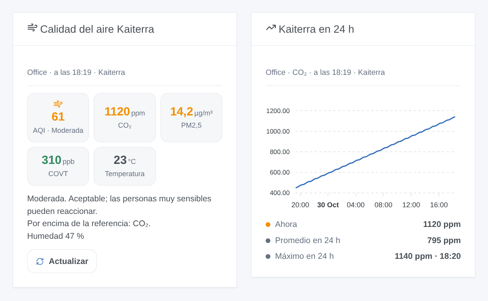

# Kaiterra

## Presentación

[Kaiterra](https://www.kaiterra.com) fabrica medidores de calidad del aire interior: el **Sensedge** y el **Sensedge Mini** para oficinas y viviendas, y la familia **Laser Egg**. Según el modelo y sus módulos, miden las **partículas** (PM1, PM2,5, PM10), el **CO₂**, los **compuestos orgánicos volátiles** (COVT), la temperatura, la humedad y a veces la presión, el NO₂, el ozono, el CO, la luminosidad y el movimiento. Cada dispositivo envía una medición por minuto a la nube de Kaiterra.

Esta integración los lleva a Gladys mediante la [API oficial de Kaiterra](https://dev.kaiterra.com): un dispositivo por medidor, desencadenantes de escena cuando el aire empeora, cuando un valor supera su referencia o cuando un medidor se desconecta, una acción de escena y dos widgets de panel. Solo lee: no se cambia nada en sus dispositivos.

El **AQI** mostrado es el índice estadounidense de calidad del aire de las partículas (el de las apps de Kaiterra), calculado a partir de las PM2,5 (umbrales de 2024) y las PM10: buena (0-50), moderada (51-100), dañina para grupos sensibles (101-150), dañina (151-200), muy dañina (201-300), peligrosa (301-500). El nivel siempre se deduce del valor.

## Requisitos previos

- Gladys Assistant **5.3.0** o posterior (palabras clave del catálogo). Las instancias anteriores no pueden instalar la integración.
- Uno o varios dispositivos Kaiterra, configurados en la app Kaiterra y conectados a Internet.
- Una clave de API de Kaiterra y el identificador de cada dispositivo (abajo).

### Obtener una clave de API

1. Inicie sesión en [app.kaiterra.com](https://app.kaiterra.com) con la cuenta a la que pertenecen sus dispositivos.
2. Abra **Account Settings** (ajustes de la cuenta), luego **API Keys**, y haga clic en **Generate API Key**. Copie la clave.

Un dispositivo de una organización solo se puede leer con una clave creada por un miembro de esa organización.

### Encontrar el identificador de un dispositivo

La API no puede listar sus dispositivos: la integración necesita el **identificador único** (UDID) de cada uno, 32 dígitos hexadecimales como `46048117-86a7-488e-9c58-708f3470ee11`. La app móvil Kaiterra lo muestra en los ajustes del dispositivo; un Sensedge también lo muestra en sus propios ajustes. Trátelo como una contraseña: no lo publique nunca.

## Configuración

| Campo                                      | Qué introducir                                                                                                      |
| ------------------------------------------ | ------------------------------------------------------------------------------------------------------------------- |
| Clave de API                               | La clave de su cuenta Kaiterra. Guardada como secreto, nunca se vuelve a mostrar ni se escribe en los registros.    |
| Identificadores de los dispositivos (UDID) | El identificador de cada dispositivo, con o sin guiones, separados por comas, espacios o saltos de línea. Hasta 20. |
| Referencia de CO₂ (ppm)                    | Por encima, el CO₂ activa el desencadenante «valor de referencia superado» y se vuelve naranja. 1000 por defecto.   |
| Referencia de COVT (ppb)                   | Lo mismo para los compuestos orgánicos volátiles. 500 por defecto.                                                  |
| Idioma de los textos                       | Nombres de los dispositivos y textos para las escenas. Automático: el idioma del último widget mostrado.            |

Dos botones completan la pantalla: **Leer ahora** (comprueba la clave y lee ahora cada dispositivo, con su nombre y sus módulos de sensores) y **Diagnóstico** (el estado de la integración en sus registros, sin la clave ni los identificadores de los dispositivos).

Las demás referencias son los valores guía 2021 de la OMS:

| Contaminante | Referencia | Base del valor de la OMS |
| ------------ | ---------- | ------------------------ |
| PM2,5        | 15 µg/m³   | media de 24 horas        |
| PM10         | 45 µg/m³   | media de 24 horas        |
| NO₂          | 25 µg/m³   | media de 24 horas        |
| Ozono        | 100 µg/m³  | media de 8 horas         |
| CO           | 3,5 ppm    | media de 24 h (4 mg/m³)  |

La integración los compara con la última medición, como hace un medidor: una indicación, no una medición reglamentaria.

## Uso

### Dispositivos

Abra la pestaña **Descubrir** de la integración y cree un dispositivo por medidor («Kaiterra Office»), con el nombre de la app Kaiterra. Cada dispositivo ofrece lo que mide el medidor:

- **Índice de calidad del aire (AQI)** y **Calidad del aire**, su nivel como texto;
- **PM2,5** y **PM10** (µg/m³), **CO₂** (ppm), **Compuestos orgánicos volátiles (COVT)** (ppb);
- **Temperatura** (°C, convertida desde °F si hace falta), **Humedad** (%);
- cuando el medidor los tiene: **Presión atmosférica** (hPa), **Dióxido de nitrógeno (NO₂)** y **Ozono (O₃)** (convertidos de ppb a µg/m³), **Luminosidad** (lx), **Movimiento**, **Punto de rocío**.

Un valor que el medidor no envió conserva el último: no se inventa ningún 0. Una funcionalidad ofrecida no desaparece nunca. Las PM1 y el CO no tienen categoría en Gladys: están en la acción de escena.

La integración lee todos los dispositivos con una solicitud por minuto. Lee los nombres y los módulos de sensores cada 6 horas, y los promedios horarios de las últimas 24 horas cada 30 minutos.

### Widgets del panel

- **Calidad del aire Kaiterra**: el AQI en el color de su nivel, luego el CO₂, las PM2,5, los COVT y la temperatura (o lo que mide el medidor), en verde por debajo del 90 % de su referencia, en naranja hasta el doble, en rojo por encima; el consejo del nivel, los valores por encima de su referencia, la humedad, un medidor desconectado o un módulo desgastado; y un botón **Actualizar**.
- **Kaiterra en 24 h**: una medida (CO₂, AQI, PM2,5, PM10, COVT, temperatura o humedad) en promedios horarios de las últimas 24 horas, con el valor actual, el promedio y la hora más alta.

Ambos tienen el ajuste **Dispositivo** (el primero por defecto).

### Escenas

Desencadenantes:

- **Kaiterra: cambio de calidad del aire**: el nivel AQI cambia y se mantiene 5 minutos. Filtros: dispositivo, nuevo nivel (uno o varios), sentido (empeora, mejora). Variables: `aqi`, `level`, `level_name`, `previous_level`, `direction`, `pm25`, `pm10`, `name`.
- **Kaiterra: valor de referencia superado**: CO₂, COVT, PM2,5, PM10, NO₂, ozono o CO permanece por encima de su referencia durante 5 minutos. Filtros: dispositivo, contaminante. Variables: `pollutant_name`, `value`, `unit`, `limit`, `percent`.
- **Kaiterra: vuelta a la normalidad**: ese valor permanece por debajo del 90 % de su referencia durante 5 minutos. Mismos filtros y variables.
- **Kaiterra: dispositivo desconectado o de vuelta**: un medidor no envía nuevas mediciones durante 15 minutos, o vuelve a hacerlo. Filtros: dispositivo, estado. Variables: `state`, `last_seen`, `minutes`.
- **Kaiterra: módulo de sensor desgastado**: a un módulo de sensor de un Sensedge le queda menos del 10 % de vida útil. Variables: `module`, `bay`, `lifetime`.

Acción: **Kaiterra: leer el aire** de un dispositivo: el AQI y su nivel, todos los valores, la hora de la medición, conectado o no, y una frase `summary` lista para usar. Nunca activa un desencadenante.

Ejemplos:

- Cuando **el CO₂ de la oficina supera su referencia** → enviar `Abra una ventana: CO₂ {{triggerEvent.data.value}} ppm` a su teléfono; cuando **vuelve a la normalidad** → una breve confirmación.
- Cuando **la calidad del aire se vuelve dañina** → poner el purificador a toda velocidad; cuando vuelve a ser **buena** → volver al modo automático.
- Cuando **un dispositivo se desconecta** → una notificación para comprobar su Wi-Fi.

### Transporte

Nube (`"transports": ["cloud"]`): la integración contacta con `api.kaiterra.com` por HTTPS con su clave y los identificadores de sus dispositivos; Kaiterra ya tiene sus mediciones. Nada más sale de su red. Las últimas mediciones, el historial de las últimas 24 horas y lo que los desencadenantes ya anunciaron se guardan en el volumen `/data` de la integración: un reinicio no activa nada dos veces.

## Solución de problemas

- **Kaiterra rechazó la clave de API**: cópiela de nuevo desde app.kaiterra.com (sin espacios) y guarde la configuración.
- **Dispositivo N: Kaiterra no conoce este identificador**: compruebe el identificador en la app Kaiterra; la posición N es el orden de los identificadores en la configuración.
- **Dispositivo N: pertenece a una organización de la que esta clave no forma parte**: cree la clave con una cuenta de esa organización.
- **No es un identificador de dispositivo**: un identificador tiene 32 dígitos hexadecimales; un nombre o un número de serie no lo es.
- **Un dispositivo parece desconectado**: no ha enviado nada desde hace 15 minutos. Compruebe su alimentación y su Wi-Fi en la app Kaiterra.
- **¿Sigue bloqueado?**: pulse **Diagnóstico** y abra una issue en [GitHub](https://github.com/William-De71/gladys-kaiterra/issues) con las versiones de Gladys y de la integración, y las líneas «Kaiterra diagnostic» de los registros (añada `DEBUG=gladys-integration-sdk` en modo desarrollador).

Datos proporcionados por Kaiterra. Esta integración comunitaria no está afiliada a Kaiterra.
